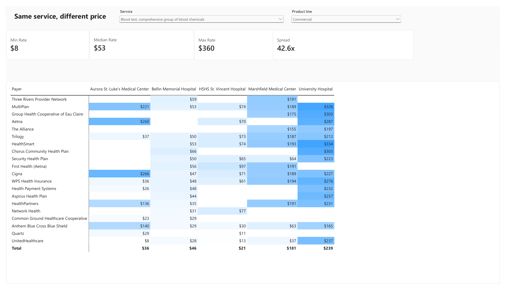
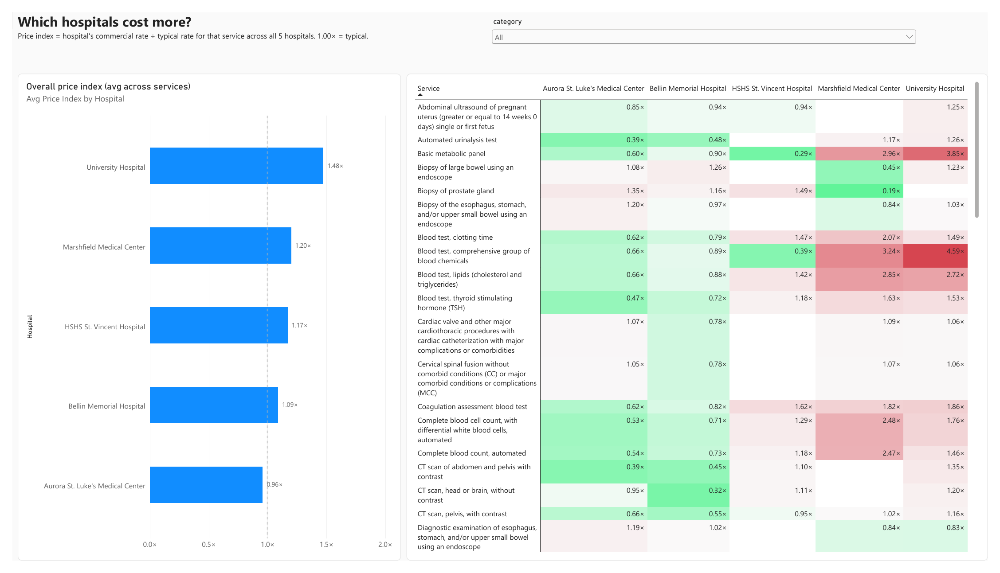
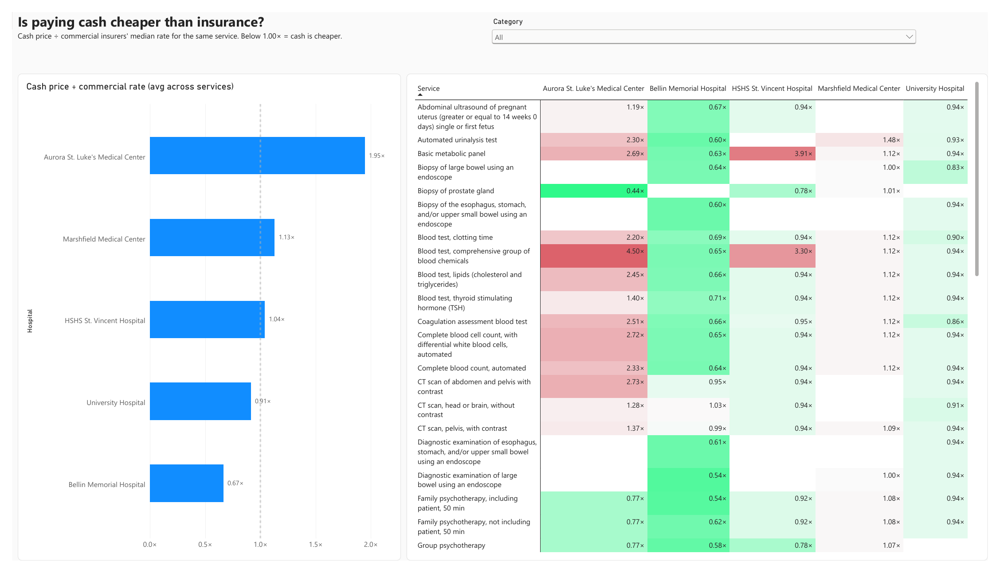

# Wisconsin hospital price transparency

How much do insurers pay Wisconsin hospitals for the same service, and how much does
it vary? Since 2021 hospitals have had to publish their negotiated rates under the CMS
Hospital Price Transparency rule. This project downloads those files for five
hospitals, loads and checks them in DuckDB, models them in SQL and reports on them in
Power BI.

Python, DuckDB, SQL and Power BI. 5 hospitals, 5.3 million payer-specific rates, and the
70 shoppable services CMS requires hospitals to list.



## Findings
- The same lab test is priced up to 40 times apart. For a comprehensive metabolic panel
  (CPT 80053), commercial rates run from $8 to $360. UnitedHealthcare pays $8 at Aurora
  St. Luke's and $237 at University Hospital in Madison for the same test.
- Some hospitals are expensive across the board. Compared with the typical rate for each
  service, University Hospital averages 1.48x and Marshfield 1.20x, while Aurora
  St. Luke's is at 0.96x. Lab tests vary the most. Major inpatient procedures such as
  cardiac valve surgery and spinal fusion stay between 0.78x and 1.09x.
- Paying cash can cost double, or a third less. Aurora's cash price averages 1.95x what
  commercial insurers pay; at Bellin Memorial it is 0.67x. University Hospital (0.94x)
  and Marshfield (1.12x) keep almost the same ratio for every service, which suggests
  they set cash prices as a fixed share of their charges.

## Report
The Power BI report is in [`report/`](report/): the
[.pbix file](report/wi-hospital-prices.pbix) (opens in the free Power BI Desktop) and a
[PDF export](report/wi-hospital-prices.pdf).

| Which hospitals cost more? | Is paying cash cheaper? |
|---|---|
|  |  |
| Price index per service and hospital, where 1.00x is the typical rate | Cash price divided by the commercial rate |

## How it works
1. [`scripts/download.sh`](scripts/download.sh) downloads each hospital's file listed in
   [`config/sources.csv`](config/sources.csv) (about 1.3 GB).
2. [`src/wihp/load.py`](src/wihp/load.py) reads both CMS v3 CSV layouts (one row per
   payer, or one column per payer) into four DuckDB tables: `hospital`, `item`,
   `item_code` and `rate`.
3. [`src/wihp/checks.py`](src/wihp/checks.py) runs data-quality checks: template version,
   orphan rates, negative amounts, code formats and unmapped payer names.
4. [`sql/model.sql`](sql/model.sql) builds the analysis views on the shoppable services.
5. [`src/wihp/export.py`](src/wihp/export.py) writes a star schema to Parquet for Power BI.

Tests in [`tests/`](tests/) run the loader and model on small synthetic files, in CI on
every push.

| SQL view | One row per |
|---|---|
| `shoppable_rate` | payer-specific dollar rate (hospital, service, payer, product line) |
| `hospital_service_payer` | hospital, service, payer and product line, with the median rate |
| `hospital_service` | hospital and service: commercial median, min, max, cash price, gross charge |
| `service_spread` | service: spread of commercial rates across all hospitals |

## Design choices
- I surveyed 19 Wisconsin hospitals. 18 published a downloadable file, all on CMS template
  v3.0. I picked five from five different health systems, including two in Green Bay so
  rates can be compared within one market.
- The service list is the 70 CMS shoppable services
  ([`config/shoppable_services.csv`](config/shoppable_services.csv), from the 2019 final
  rule, 84 FR 65524). It is a published, recognizable list that every hospital has to cover.
- Payer names differ between files ("Anthem", "ANTHEM", "Anthem BCBS of WI"), so
  [`config/payer_map.csv`](config/payer_map.csv) groups the 159 raw names into 66 parent
  payers. Product line (commercial, Medicare Advantage, Medicaid) comes from keywords in
  the payer and plan names.
- I use medians rather than averages because a few extreme contracts would pull an
  average far off.
- To compare hospitals across services that cost $10 or $40,000, the report uses a price
  index: a hospital's rate divided by the typical rate for that service.
- DuckDB loads all five files in under a minute from a single file, with no database server.
- The report ships as a .pbix file and PDF, because publishing Power BI to the web needs
  an organizational account.

## Run it
```sh
python -m venv .venv && .venv/bin/pip install -e ".[dev]"
scripts/download.sh
.venv/bin/python -m wihp.load       # -> data/wihp.duckdb
.venv/bin/python -m wihp.model
.venv/bin/python -m wihp.checks     # exits non-zero if a check fails
.venv/bin/python -m wihp.export     # -> data/export/*.parquet
.venv/bin/pytest
```

## Data and limitations
All data comes from files the hospitals publish under 45 CFR 180; there is no patient
data. The hospitals are Aurora St. Luke's Medical Center (Milwaukee), Bellin Memorial
Hospital and HSHS St. Vincent Hospital (Green Bay), Marshfield Medical Center, and
University Hospital (UW Health, Madison).
- The files list contracted rates, not paid claims, and say nothing about volume, so the
  medians are not weighted by how often a service is billed.
- Only facility rates stated in dollars are used. Rows with modifiers and rates given as a
  percent of charges are left out.
- The files were published between November 2025 and June 2026, so they cover different
  contract periods.
- The checks found problems in the source files: one hospital drops leading zeros from
  CPT codes (repaired), two label internal charge codes as HCPCS (excluded), and payer
  names are not standardized (mapped by hand).
